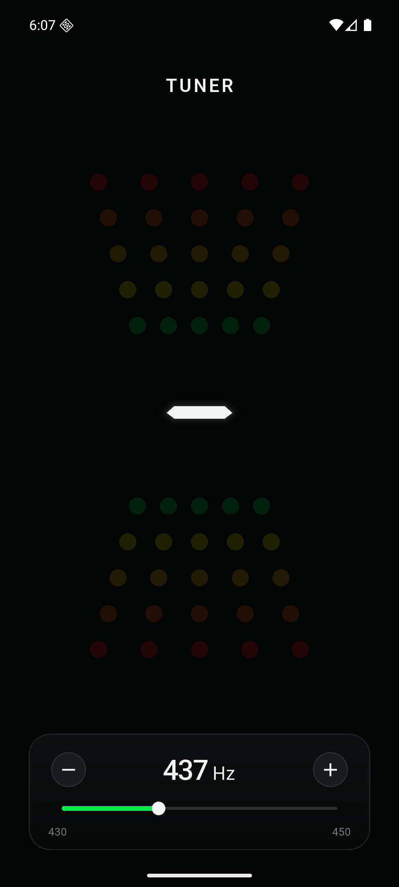

# Tuner

## 기능

- 상단 TUNER 텍스트와 흰색 세그먼트 음명, 오른쪽 아래 옥타브
- C / C# / D / D# / E / F / F# / G / G# / A / A# / B 표시
- 위·아래 LED: 높은 음은 위쪽, 낮은 음은 아래쪽으로 누적 점등
- 중앙부터 초록 → 노랑 → 주황 → 주홍 → 빨강, 정음은 중앙 초록 화살표
- 하단 패널에서 A4 기준 430~450 Hz를 버튼·슬라이더로 변경하고 기기에 저장
- 별도 isolate에서 YIN 기본 주파수 분석, 무음·잡음 필터링과 표시 안정화
- 마이크 권한·오디오 중단·앱 백그라운드 처리. 오디오 파일 저장 및 외부 전송 없음
- 화면 비율·회전에 따른 자동 배치와 노치·카메라·하단 시스템 내비게이션 안전 여백
